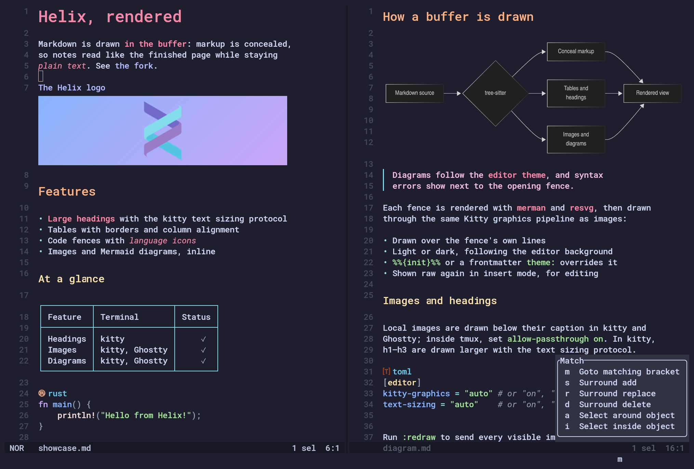

<div align="center">

<h1>
<picture>
  <source media="(prefers-color-scheme: dark)" srcset="logo_dark.svg">
  <source media="(prefers-color-scheme: light)" srcset="logo_light.svg">
  
</picture>
</h1>

[](https://github.com/mhersson/helix/actions/workflows/build.yml)
[](https://github.com/mhersson/helix/releases/latest)

</div>



A personal fork of the Helix editor: a [Kakoune](https://github.com/mawww/kakoune)
/ [Neovim](https://github.com/neovim/neovim) inspired modal editor written in
Rust, with multiple selections, built-in language server support and
tree-sitter powered syntax highlighting and editing.

## Standing on the shoulders of Helix

Everything good in this editor starts with the Helix editor project and its
many contributors. Their years of careful work on the editing model, the
tree-sitter integration, the language server client and the countless details
that make Helix a joy to use are the foundation this fork is built on. This
fork branched from upstream commit `ba40e5474` (2026-09-29); since then I
pick individual upstream changes, such as grammar updates and fixes, when I
want them. Thank you, all of you.

## Why this fork

These days I spend more and more of my time reading and writing Markdown, and
less of it writing code. Helix is the editor I love using, so rather than
switch, I wanted it to be at its best for prose too. This fork is where I add
the features that make working with Markdown more enjoyable, together with a
handful of upstream pull requests I wanted to have.

## Fork features

### Markdown

Markdown is rendered right in the buffer: markup is concealed and replaced by
its rendered form, so the document reads like the finished page while staying
plain text.

- Normal mode is fully rendered; in insert mode the block under the cursor is
  shown raw, so you always edit the real source.
- Headings, emphasis, links, lists, block quotes, code blocks and tables (with
  column alignment and borders) are rendered. A table's top and bottom borders
  take one extra row each, kept blank while the table is shown raw so nothing
  moves. A table on the first line has no top border, and one at the end of a
  file without a trailing newline has no bottom border.
- Local images (``) are drawn below their caption with Kitty
  graphics placeholders in kitty and Ghostty. Configure with
  `[editor] kitty-graphics = "auto" | "on" | "off"`; inside tmux it needs
  `set -g allow-passthrough on`.
- In kitty, h1–h3 headings are drawn larger (2×, 1.5×, 1.25×) with the text
  sizing protocol, one extra row each; the heading under the cursor and
  headings that don't fit are drawn at normal size. Configure with
  `[editor] text-sizing = "auto" | "on" | "off"` (`auto` probes at startup);
  other terminals and tmux are unchanged. Closing `#`s (`# Title ##`) are
  concealed while rendering.
- ```` ```mermaid ```` fences are rendered as diagrams that follow the editor
  theme; syntax errors are shown after the opening fence.
- On by default via `markdown-render = true` in `languages.toml`; toggle per
  document with `:markdown-render [on|off]` or `toggle_markdown_render`.
- Live preview with the [mpls](https://github.com/mhersson/mpls) Markdown
  language server: `mpls/editorDidChangeFocus` notifications make its browser
  preview follow the file you are editing (`[editor.lsp] mpls-focus-notify`).

### Ported upstream pull requests

- **Inline git blame** (upstream PR #13133): author, time and commit shown as
  virtual text at the end of lines.
- **Ghost text** (upstream PR #14876): `textDocument/inlineCompletion` support,
  for example with copilot-language-server.
- **Keymap labels** (upstream PR #3958): labels for custom menus, typable
  commands, macros and command sequences in the which-key popup.
- **Rounded corners** (upstream PR #11497): `editor.rounded-corners` draws
  rounded borders.
- **Native cursor** (upstream PR #14951): the `native` cursor shape lets the
  terminal draw the cursor in its own configured shape (e.g. with cursor
  trails).
- **Scrollable picker preview** (upstream PR #15854): scroll the preview with
  `PageUp`/`PageDown` and `Alt-k`/`Alt-j`.
- **Selection history** (upstream PR #15775): `undo_selection`/`redo_selection`
  on `Alt-k`/`Alt-w`.
- **Window resizing** (upstream PR #14559): resize splits in the sticky resize
  mode under `C-w r`.
- **Custom typable commands** (upstream PR #12320): define your own `:` commands
  in `[commands]`.
- **Trailing whitespace** (upstream PR #7215): `whitespace.render = "trailing"`,
  styled with `ui.virtual.trailing-whitespace`; Markdown hard breaks are not
  marked while Markdown is rendered.
- **Breadcrumbs** (upstream PR #15573): `[editor.breadcrumb]` shows the file
  path and the LSP symbols around the cursor at the top of each view.
- **Diff source autodetection** (upstream PR #9951): the diff provider is
  detected and cached per repository.
- **Jujutsu diff provider** (upstream PR #12022): diff gutter, statusline and
  changed-files picker for Jujutsu repositories, in fully trusted workspaces
  only. Falls back to git when `jj` can't be used.
- **File watching** (upstream PR #14544): reload files changed on disk
  (`[editor.auto-reload]`, `[editor.file-watcher]`), prompting if the buffer
  has unsaved changes.
- **Icons** (upstream PR #12369): `[icons]` sets file, kind, diagnostic, VCS
  and UI glyphs. **Breaking:** `[editor.statusline] separator` moved to
  `[icons.ui.statusline]` (old configs with it fail to load), whitespace
  characters moved to `[icons.ui.virtual]`, and `[editor.soft-wrap]
  wrap-indicator` is ignored (use `[icons.ui.virtual] wrap`).

## Installation

Release binaries will be published on the
[releases page](https://github.com/mhersson/helix/releases) once `vYYYY.MM.N`
tags exist. Until then, build from source (needs the Rust toolchain, Git and a
C++14 compiler for the tree-sitter grammars):

```sh
git clone https://github.com/mhersson/helix
cd helix
cargo install --path helix-term --locked
```

This installs `hx` and builds the tree-sitter grammars into `runtime/`. Point
Helix at that runtime directory, either with a symlink:

```sh
ln -Tsf $PWD/runtime ~/.config/helix/runtime
```

or by exporting `HELIX_RUNTIME=/path/to/helix/runtime` in your shell profile.
Grammars can be refetched and rebuilt with `hx --grammar fetch` and
`hx --grammar build`, and `hx --health` checks the setup. See
[Building from source](./book/src/building-from-source.md) for Windows,
optimized builds and packaging.

## Documentation

The documentation lives in the book sources under [`book/src`](./book/src/SUMMARY.md):

- [Usage](./book/src/usage.md) and [keymap](./book/src/keymap.md)
- [Configuration](./book/src/configuration.md), [editor options](./book/src/editor.md)
  and [languages](./book/src/languages.md)
- [Icons](./book/src/icons.md) and [custom commands](./book/src/custom-commands.md)

Only some languages have indentation definitions; check
`runtime/queries/<lang>/` for `indents.scm`.

## Getting help and contributing

Questions, bug reports and suggestions are welcome as
[issues](https://github.com/mhersson/helix/issues). The contributing guidelines
are in [docs/CONTRIBUTING.md](./docs/CONTRIBUTING.md).

## Credits

This editor exists thanks to the Helix editor project and every one of its
contributors.
